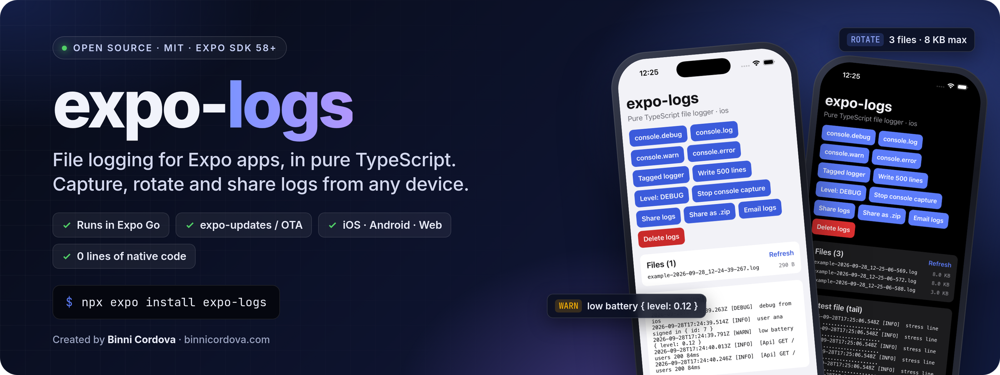
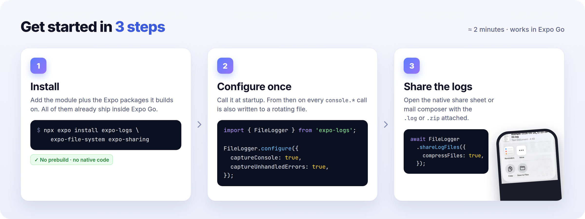
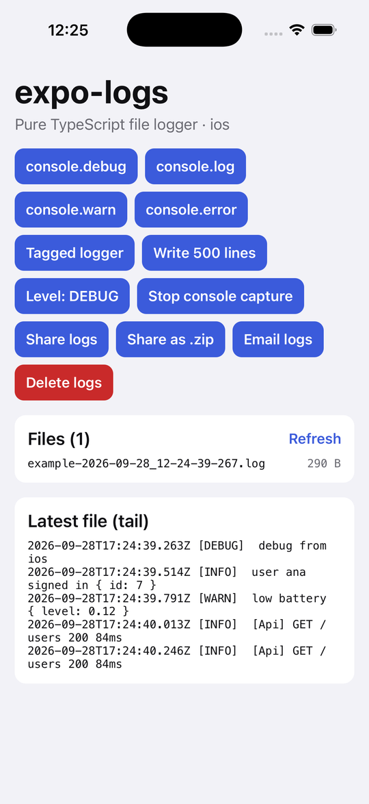
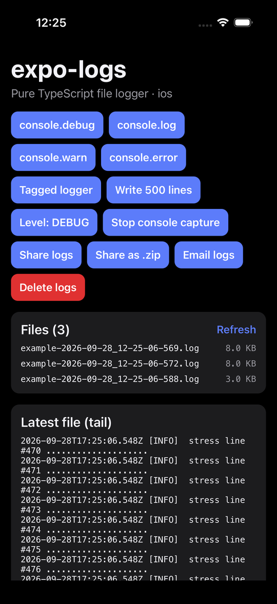
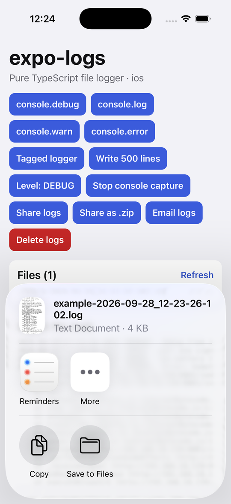
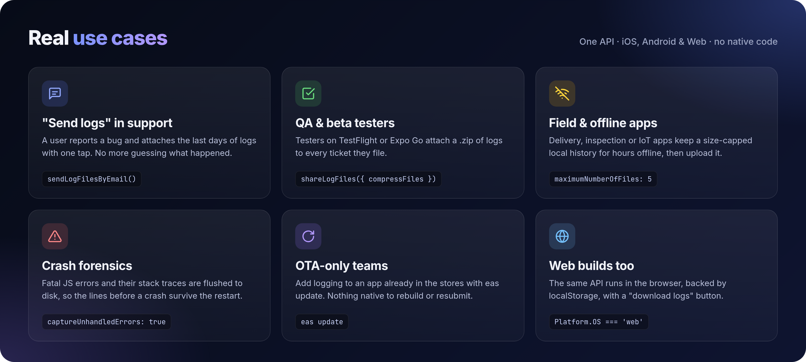

<p align="center">
  
</p>

<h1 align="center">expo-logs</h1>

<p align="center">
  <b>A file logger for Expo apps, written in pure TypeScript.</b><br/>
  Runs in Expo Go · Ships over expo-updates · iOS, Android &amp; Web
</p>

<p align="center">
  <a href="https://www.npmjs.com/package/expo-logs"></a>
  <a href="./LICENSE"></a>
  
  
  
</p>

<p align="center">
  Created by <a href="https://binnicordova.com"><b>Binni Cordova</b></a>, Senior Software Engineer &amp; Mobile Architect<br/>
  <a href="https://binnicordova.com">BinniCordova.com</a> ·
  <a href="https://github.com/binnicordova">GitHub</a> ·
  <a href="https://www.linkedin.com/in/binnicordova">LinkedIn</a> ·
  <a href="https://www.npmjs.com/~binnizenobiocordovaleandro">npm</a> ·
  <a href="https://play.google.com/store/apps/developer?id=BinniCordova.com">Google Play</a>
</p>

---

## Get started in 3 steps

<p align="center">
  
</p>

**1. Install**

```sh
npx expo install expo-logs expo-file-system expo-sharing
```

**2. Configure once, at startup**

```ts
import { FileLogger } from 'expo-logs';

FileLogger.configure({ captureConsole: true, captureUnhandledErrors: true });
```

Every `console.log/info/warn/error/debug` call is now also written to a rotating file on the device.

**3. Let users send you their logs**

```ts
await FileLogger.shareLogFiles({ compressFiles: true });
```

## See it running

Real screenshots of the [example app](./example), running in Expo Go on the iOS Simulator (iPhone 17, iOS 26.5):

<table>
  <tr>
    <td align="center" width="33%"></td>
    <td align="center" width="33%"></td>
    <td align="center" width="33%"></td>
  </tr>
  <tr>
    <td align="center"><sub><b>Capture</b><br/><code>console.*</code> and tagged loggers written to disk</sub></td>
    <td align="center"><sub><b>Rotate</b><br/>500 lines → 8 KB files, only the newest 3 kept</sub></td>
    <td align="center"><sub><b>Share</b><br/>Native share sheet with the <code>.log</code> (or <code>.zip</code>)</sub></td>
  </tr>
</table>

## Real use cases

<p align="center">
  
</p>

- **"Send logs" button in support.** A user reports a bug; one tap attaches the last few days of logs to an email (`sendLogFilesByEmail`) or the share sheet (`shareLogFiles`). No more "can you describe exactly what you did?".
- **QA and beta builds.** Testers on TestFlight, internal tracks or Expo Go export a `.zip` of logs with every ticket, while `logLevel: LogLevel.Debug` stays off in production.
- **Field and offline apps.** Delivery, inspection or IoT apps that run for hours without a connection keep a local, size-capped history (`maximumFileSize`, `maximumNumberOfFiles`) that can be uploaded later with `getLogFilePaths()`.
- **Crash forensics.** With `captureUnhandledErrors: true`, the stack trace of a fatal JS error is flushed to disk, so you can read the lines that led up to it on the next launch.
- **OTA-only teams.** Add logging to an app that's already in the stores with `eas update`, since there's no native code to rebuild.
- **Web builds.** The same API works in the browser (backed by `localStorage`), so an Expo Router web app can offer the same "download logs" button.

## About

`expo-logs` writes your app's logs to rotating files on the device, captures `console.*` output, and lets users share or email the logs to you. It has **no native code**: it's built on modules that already ship inside Expo Go (`expo-file-system`, `expo-sharing`, `expo-mail-composer`), so it:

- runs in **Expo Go**, with no development build or prebuild,
- can be added or upgraded through **expo-updates / EAS Update** (OTA), since it's plain JavaScript,
- works the same on **iOS, Android and Web**.

The API follows [`react-native-file-logger`](https://github.com/BeTomorrow/react-native-file-logger), so migrating is mostly an import change.

## Contents

- [Get started in 3 steps](#get-started-in-3-steps)
- [See it running](#see-it-running)
- [Real use cases](#real-use-cases)
- [About](#about)
- [Contents](#contents)
- [Installation](#installation)
- [Quick start](#quick-start)
- [Configuration](#configuration)
- [API](#api)
  - [Writing](#writing)
  - [Level and console capture](#level-and-console-capture)
  - [Files](#files)
  - [Errors](#errors)
  - [Other exports](#other-exports)
- [How files are written](#how-files-are-written)
- [Platform notes](#platform-notes)
- [Migrating from react-native-file-logger](#migrating-from-react-native-file-logger)
- [Example app](#example-app)
- [Contributing](#contributing)
- [Author](#author)
- [License](#license)

## Installation

Requires **Expo SDK 58** or newer.

```sh
npx expo install expo-logs expo-file-system
```

These are optional and only needed to send logs out of the device:

```sh
npx expo install expo-sharing expo-mail-composer
```

| Package              | Needed for                          | Required |
| -------------------- | ----------------------------------- | -------- |
| `expo-file-system`   | Writing log files on iOS / Android  | Yes      |
| `expo-sharing`       | `FileLogger.shareLogFiles()`        | Optional |
| `expo-mail-composer` | `FileLogger.sendLogFilesByEmail()`  | Optional |

All three are included in Expo Go. `.zip` export uses [fflate](https://github.com/101arrowz/fflate), a small pure-JS dependency.

## Quick start

Configure the logger once, as early as possible (for example in `index.ts` or your root `_layout.tsx`):

```ts
import { FileLogger, LogLevel } from 'expo-logs';

FileLogger.configure({
  logLevel: __DEV__ ? LogLevel.Debug : LogLevel.Info,
  captureConsole: true, // console.log/info/warn/error/debug also go to the file
  captureUnhandledErrors: true, // record uncaught JS errors
});
```

From then on, every `console.*` call is also written to the log file. You can log directly too:

```ts
FileLogger.info('User signed in', { id: user.id });
FileLogger.warn('Slow request: %s took %dms', url, 1840);
FileLogger.error(error); // Errors are written with their stack trace

const log = FileLogger.createLogger('Payments');
log.info('checkout started'); // "... [INFO]  [Payments] checkout started"
```

Let users send you their logs:

```ts
import { ExpoLogsError, FileLogger } from 'expo-logs';

async function reportProblem() {
  try {
    await FileLogger.sendLogFilesByEmail({
      to: 'support@example.com',
      subject: 'Bug report',
      body: 'Describe what happened:',
      compressFiles: true,
    });
  } catch (error) {
    // No mail account on the device (e.g. iOS Simulator): fall back to the share sheet.
    if (error instanceof ExpoLogsError && error.code === 'ERR_MAIL_UNAVAILABLE') {
      await FileLogger.shareLogFiles({ compressFiles: true });
    } else {
      throw error;
    }
  }
}
```

## Configuration

`FileLogger.configure(options?: ConfigureOptions): Promise<void>`

| Option                   | Type                                      | Default                          | Description                                                                                  |
| ------------------------ | ----------------------------------------- | -------------------------------- | -------------------------------------------------------------------------------------------- |
| `logLevel`               | `LogLevel`                                | `LogLevel.Debug`                 | Minimum level written to the file. Console output is not affected.                           |
| `formatter`              | `(level: LogLevel, msg: string) => string` | `defaultFormatter`               | Builds each line. The default gives `2026-09-28T15:04:05.123Z [INFO]  message`.               |
| `captureConsole`         | `boolean`                                 | `true`                           | Mirror `console.debug/log/info/warn/error` into the file.                                    |
| `captureUnhandledErrors` | `boolean`                                 | `false`                          | Record uncaught errors (`ErrorUtils` on native; `error` / `unhandledrejection` on web).      |
| `dailyRolling`           | `boolean`                                 | `true`                           | Start a new file when the local date changes.                                                 |
| `maximumFileSize`        | `number` (bytes)                          | `1048576` (1 MB)                 | Start a new file when the current one would exceed this size. `0` disables.                  |
| `maximumNumberOfFiles`   | `number`                                  | `5`                              | Keep at most this many files, deleting the oldest. `0` disables.                              |
| `logsDirectory`          | `string`                                  | `Paths.cache/logs`               | Where to store the files: a `file://` URI or an absolute path. On web, a storage namespace.  |
| `logPrefix`              | `string`                                  | `''`                             | Prefix for file names, e.g. `'myapp-'` gives `myapp-2026-09-28_10-15-00-123.log`.              |
| `flushInterval`          | `number` (ms)                             | `500`                            | How long writes are batched before going to disk. `0` writes on every call.                  |

To keep logs somewhere the OS won't clean up, use the document directory:

```ts
import { Paths } from 'expo-file-system';

FileLogger.configure({ logsDirectory: `${Paths.document.uri}logs` });
```

`configure()` can be called again at any time, for example to change the level or the directory. Pending lines are written to the previous configuration first.

## API

All methods are on the shared `FileLogger` instance (also the default export).

### Writing

| Method                                  | Description                                                                        |
| --------------------------------------- | ---------------------------------------------------------------------------------- |
| `debug(...args)` / `info(...args)`      | Log at `Debug` / `Info`. Arguments are formatted like `console.log`, `%s %d %i %f %j %o %O` included. |
| `warn(...args)` / `error(...args)`      | Log at `Warning` / `Error`.                                                        |
| `write(level, msg)`                     | Append a pre-formatted message at the given level.                                 |
| `createLogger(tag)`                     | Return `{ debug, info, warn, error }` that prefix every message with `[tag]`.      |
| `flush(): Promise<void>`                | Write buffered lines to disk now. Also runs automatically when the app goes to the background. |

### Level and console capture

| Method                                   | Description                                    |
| ---------------------------------------- | ---------------------------------------------- |
| `setLogLevel(level)` / `getLogLevel()`   | Change or read the minimum level.              |
| `enableConsoleCapture()`                 | Start mirroring `console.*` into the file.     |
| `disableConsoleCapture()`                | Restore the original `console` methods.        |
| `isConsoleCaptureEnabled()`              | Whether capture is on.                         |
| `isConfigured()`                         | Whether `configure()` has finished.            |

### Files

| Method                                              | Description                                                                                  |
| --------------------------------------------------- | -------------------------------------------------------------------------------------------- |
| `getLogFiles(): Promise<LogFileInfo[]>`             | `{ name, uri, size, modificationTime }` for each log file, oldest first.                     |
| `getLogFilePaths(): Promise<string[]>`              | Just the URIs (`file://…` on native), oldest first.                                          |
| `readLogFile(nameOrUri?): Promise<string>`          | Contents of one file, or of all files merged when called without an argument.                |
| `deleteLogFiles(): Promise<void>`                   | Delete every log file.                                                                        |
| `shareLogFiles(options?): Promise<void>`            | Open the share sheet. Several files are merged into one `.log`, or zipped with `compressFiles: true`. |
| `sendLogFilesByEmail(options?): Promise<void>`      | Open the mail composer with the logs attached. Options: `to`, `subject`, `body`, `compressFiles`. |

### Errors

Methods reject with an `ExpoLogsError` whose `code` is one of:

| Code                         | When                                                                    |
| ---------------------------- | ----------------------------------------------------------------------- |
| `ERR_MAIL_UNAVAILABLE`       | No mail account is set up on the device (always on the iOS Simulator). |
| `ERR_MAIL_COMPOSER_MISSING`  | `expo-mail-composer` isn't installed.                                   |
| `ERR_SHARING_MISSING`        | `expo-sharing` isn't installed.                                         |
| `ERR_SHARING_UNAVAILABLE`    | The platform can't share files.                                         |
| `ERR_NO_LOGS`                | There's nothing to share yet.                                           |

### Other exports

- `LogLevel`: `Debug = 0`, `Info = 1`, `Warning = 2`, `Error = 3`.
- `defaultFormatter`, `logLevelNames`, `formatArgs(args)` and `inspect(value)`: the pieces the default output is built from, for your own formatter.
- `Logger` and `MemoryStorage`: create independent logger instances, or test code that logs without touching the file system:

  ```ts
  import { Logger, MemoryStorage } from 'expo-logs';

  const logger = new Logger(new MemoryStorage());
  await logger.configure({ captureConsole: false });
  ```

## How files are written

- **Buffered.** `write()` is synchronous and never blocks rendering. Lines are batched and appended to disk every `flushInterval` ms, straight away once 200 lines are waiting, and whenever the app leaves the foreground.
- **Nothing is lost at startup.** Up to 1,000 lines logged before `configure()` resolves are kept in memory and written once it does.
- **Rotation.** File names look like `<prefix>YYYY-MM-DD_HH-mm-ss-SSS.log`, so they sort by date. A new file starts on a new day (`dailyRolling`) or when the next line would go past `maximumFileSize`. After a rotation, the oldest files are deleted so no more than `maximumNumberOfFiles` remain.
- **Restarts.** On launch, the logger keeps appending to the newest file if it's from today and still under the size limit.
- **Safe.** Errors inside the logger are reported with the original `console.warn` and never thrown into your code, and the logger never logs its own output again.

## Platform notes

**iOS and Android** use the `expo-file-system` `File` / `Directory` API. By default logs go to `Paths.cache/logs`, the same place `react-native-file-logger` uses. The OS may clear the cache when storage runs low; set `logsDirectory` under `Paths.document` if logs must survive that.

**iOS Simulator** has no Mail app, so `sendLogFilesByEmail()` rejects with `ERR_MAIL_UNAVAILABLE`. Use `shareLogFiles()` there, or catch the error as shown in [Quick start](#quick-start).

**Web** stores each log file as a `localStorage` entry (in memory if `localStorage` isn't available, e.g. during SSR). Browsers allow about 5 MB per origin, so if space runs out the oldest files are dropped. Consider a smaller `maximumFileSize` on web. `shareLogFiles()` uses the Web Share API when the browser can share files, and downloads the file otherwise. Browsers can't attach files to email, so `sendLogFilesByEmail()` downloads the logs and opens a `mailto:` link with the recipients, subject and body filled in.

**expo-updates / EAS Update.** `expo-logs` has no native code, so it doesn't change your runtime version or fingerprint. You can add it to an app that is already in the stores and ship it with `eas update`, as long as the store build already includes `expo-file-system` (and `expo-sharing` / `expo-mail-composer` if you use them).

## Migrating from react-native-file-logger

```diff
- import { FileLogger, LogLevel } from 'react-native-file-logger';
+ import { FileLogger, LogLevel } from 'expo-logs';
```

Then remove the old package and rebuild once, since you're dropping a native dependency. The differences are:

- `getLogFilePaths()` returns `file://` URIs, which is what `expo-file-system` and `expo-sharing` expect, instead of bare paths.
- `debug/info/warn/error` take any number of arguments of any type, like `console.log`, instead of a single string.
- New: `shareLogFiles()`, `getLogFiles()`, `readLogFile()`, `flush()`, `createLogger()`, `captureUnhandledErrors` and web support.

## Example app

The [`example`](./example) folder has an Expo Go app with buttons for every feature. It uses small rotation limits so you can watch files rotate.

```sh
bun install
cd example
bun install
bun run ios       # opens the iOS Simulator in Expo Go
bun run android   # opens the connected Android device / emulator in Expo Go
bun run web
```

The example's Metro config resolves `expo-logs` to `../src`, so changes to the library reload straight away without a build.

## Contributing

```sh
bun install
bun run typecheck
bun run lint
CI=1 bun run test
bun run build      # compiles src/ to build/
```

push your changes to a branch and open a pull request. The example app reloads the library from `src/` so you can test your changes in Expo Go without rebuilding.

## Author

<table>
  <tr>
    <td>
      <b>Binni Cordova</b>: Senior Software Engineer &amp; Mobile Architect.<br/>
      I build production React Native / Expo apps and developer tools. If <code>expo-logs</code> helps you, a ⭐ on GitHub is appreciated.<br/><br/>
      🌐 <a href="https://binnicordova.com">BinniCordova.com</a><br/>
      💻 <a href="https://github.com/binnicordova">github.com/binnicordova</a><br/>
      💼 <a href="https://www.linkedin.com/in/binnicordova">linkedin.com/in/binnicordova</a><br/>
      📦 <a href="https://www.npmjs.com/~binnizenobiocordovaleandro">More packages on npm</a><br/>
      📱 <a href="https://play.google.com/store/apps/developer?id=BinniCordova.com">Apps on Google Play</a>
    </td>
  </tr>
</table>

Need help adding logging, OTA updates or observability to your Expo app? [Get in touch through BinniCordova.com](https://binnicordova.com).

## License

MIT © [Binni Cordova](https://binnicordova.com)
